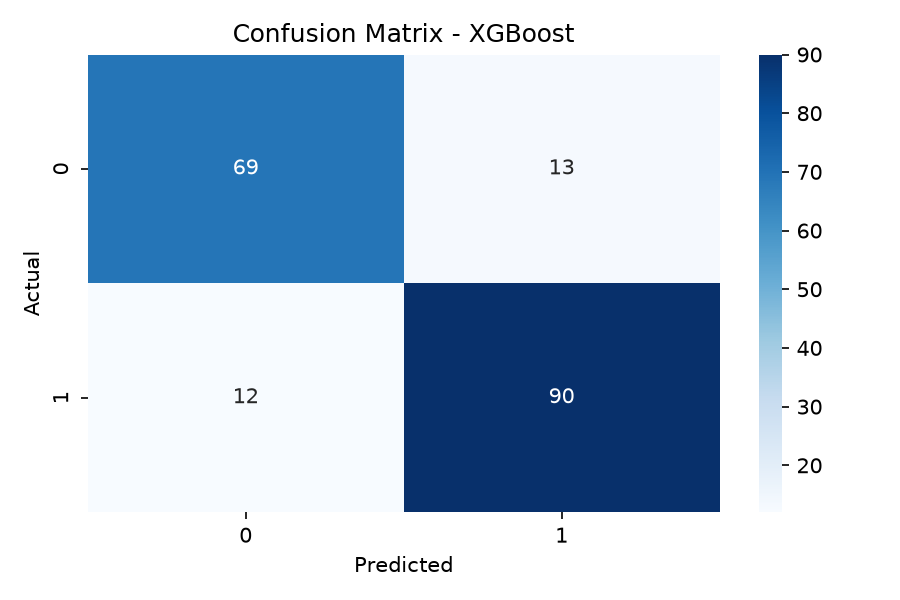
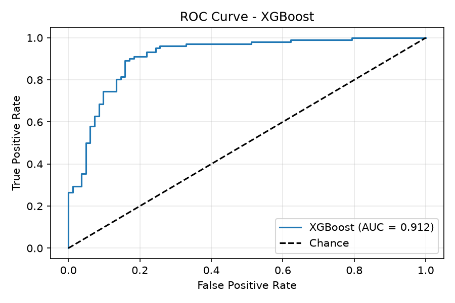

# Heart Disease Prediction

**Author: Getamesay Zegeye (Get-AZ)**

An educational machine learning project comparing XGBoost, Random Forest, and Decision Tree classifiers, with a Streamlit interface and an MLflow training function.

## Included files

- `heart_app/app.py`: interactive prediction form and CSV result download.
- `models/`: fitted artifacts are excluded from the public repository. Copy your own matching artifacts here before running the app.
- `data/heart.csv`: excluded from the public repository. The local project dataset has 918 rows, 11 input features, and the HeartDisease target.
- `model_graphs/`: supplied evaluation CSV, classification reports, confusion matrices, and ROC plots.
- `train_models.py`: cleaned active MLflow training function from the supplied script; historical commented versions were removed.

## Run the app on Windows

From the repository root in PowerShell:

```powershell
python -m venv env
.\env\Scripts\python.exe -m pip install -r requirements.txt
.\env\Scripts\python.exe -m streamlit run heart_app/app.py
```

Before launch, copy your local `preprocessor.pkl`, `selector.pkl`, `xgboost_model.pkl`, `randomforest_model.pkl`, and `decisiontree_model.pkl` into `models/`. These files are not distributed here. Open the Local URL printed by Streamlit. The app resolves `models/` relative to the repository root. Use all artifacts from the same training run. Load pickle files only from trusted sources.

The local scikit-learn artifacts record version **1.9.1**, which is pinned in requirements. The training machine used Python 3.14. Other dependency versions were not supplied as a lockfile; export the original environment before claiming exact reproducibility.

## Supplied held-out evaluation

These results are read from the supplied `model_graphs/evaluation_summary.csv`; they were not recomputed during packaging. The reported split is 734 training and 184 test samples. Precision, recall, and F1 refer to class 1.

| Model | Accuracy | Precision | Recall | F1 | ROC-AUC |
|---|---:|---:|---:|---:|---:|
| XGBoost | 0.8641 | 0.8738 | 0.8824 | 0.8780 | 0.9122 |
| Random Forest | 0.8152 | 0.8269 | 0.8431 | 0.8350 | 0.8994 |
| Decision Tree | 0.8315 | 0.8737 | 0.8137 | 0.8426 | 0.8848 |





## Preprocessing and limitations

The supplied workflow treats zero RestingBP and Cholesterol values as missing, uses training medians for numeric imputation, encodes categories, scales numeric features, and selects features with Random Forest. Prediction applies the saved transformations without fitting again.

Preprocessing and feature selection were fitted before training cross-validation, so reported CV scores may be optimistic. Move these steps inside CV folds in a future training revision. The existing held-out test results should not be used for repeated model tuning.

`main.py`, `load_data.py`, `preprocessing.py`, and `evaluate_models.py` were not supplied in this package. The app can use your local artifacts, but full retraining is not yet packaged. `train_models(X_train, y_train)` expects already processed and selected features; running that file alone does not train models.

## MLflow

The training function records parameters and CV metrics, saves pickle models, and registers processed-feature classifiers in a local SQLite-backed MLflow store. Existing MLflow databases and run artifacts are not included.

After running training from a complete training workflow, launch the UI from the repository root:

```powershell
.\env\Scripts\python.exe -m mlflow ui --backend-store-uri sqlite:///mlflow.db --host 127.0.0.1 --port 5001 --workers 1
```

## Intended use and data provenance

Educational demonstration only; not a diagnostic tool. Model probabilities are not validated individual clinical risk estimates. No external clinical validation or calibration study is included.

The dataset was supplied locally by the project author and is not published here. Its original source URL and redistribution license have not been supplied and should be documented. No third-party dataset license or project license is inferred by this package.

## Packaging validation

Python syntax, CSV dimensions and column names, expected artifact paths, and report consistency were checked. Model deserialization, live Streamlit prediction, and retraining were not executed in the packaging environment.
